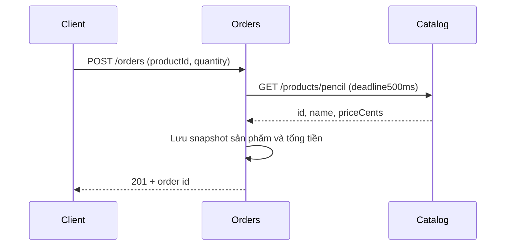

# 01 — Ranh giới dịch vụ và HTTP

Mục tiêu: tự chạy **Catalog** và **Orders** như hai dịch vụ độc lập, hiểu dữ liệu
nào thuộc dịch vụ nào và quan sát lỗi khi một dịch vụ phụ thuộc ngừng hoạt động.



## Hợp đồng và quyền sở hữu dữ liệu

Catalog sở hữu dữ liệu sản phẩm. Orders **không import bảng sản phẩm** mà hỏi qua
HTTP, rồi sở hữu snapshot và đơn hàng của mình. Tiền dùng số nguyên cent:
Pencil có `priceCents=125`, mua2 đơn vị tạo `totalCents=250`. Không dùng số thực
để cộng tiền. Đây là dữ liệu mô phỏng, không thực hiện thanh toán.

| Dịch vụ | Yêu cầu | Kết quả |
|---|---|---|
| Cả hai | GET /health | 200, trạng thái sống của chính tiến trình |
| Catalog | GET /products/pencil | 200, sản phẩm; không có trả404 |
| Orders | POST /orders | 201, đơn mới và header Location |
| Orders | GET /orders/:id | 200, snapshot đã lưu; không có trả404 |

Body tạo đơn chỉ có `productId` theo `[a-z0-9-]{1,32}` và `quantity` nguyên1..100.
Không nhận giá từ client. JSON sai hoặc giá trị sai trả400; loại nội dung sai415;
body vượt8192 byte trả413; gọi sai method trên route có thật trả405.
Sản phẩm không có trả422. Catalog không kết nối được/không sẵn sàng trả503;
deadline hết trả504; dữ liệu sản phẩm sai hợp đồng trả502. Lỗi có cấu trúc
`{"error":{"code":"...","message":"..."}}`, không gửi stack trace cho client.

## Chạy bằng Node

Từ gốc repo, sau `npm ci --ignore-scripts`, mở hai terminal:

```sh
# Terminal1
node lessons/01-service-boundaries-http/catalog.mts
```

```sh
# Terminal2
CATALOG_URL=http://127.0.0.1:3101 node lessons/01-service-boundaries-http/orders.mts
```

Gửi yêu cầu bằng các lệnh curl ở README gốc. Dùng Ctrl+C để dừng từng tiến trình.
`HOST` mặc định127.0.0.1; `PORT` mặc định3101/3102, nhận0 để hệ điều hành chọn cổng.
Orders nhận `CATALOG_URL` là HTTP(S) origin và `CATALOG_TIMEOUT_MS` (1..10000,
mặc định500). Deadline bao gồm cả nhận body Catalog; phản hồi sản phẩm cũng
giới hạn8192 byte. Khi chạy Compose, Orders dùng DNS `http://catalog:3000`.

## Chạy bằng hai container

```sh
docker compose -f compose/01-service-boundaries.yaml up --build --wait
# Sau khi thực hành:
docker compose -f compose/01-service-boundaries.yaml down
```

Có thể đổi cổng host qua `CATALOG_PORT`/`ORDERS_PORT`. Dịch vụ chạy non-root,
filesystem chỉ đọc, có healthcheck; Docker image được pin theo digest. Không
cần container database cho bài đầu.

## Kiểm thử và quan sát lỗi

```sh
npm run test:unit       # Không cần mở socket: hợp đồng input của Orders
npm run check           # tsc + toàn bộ test, có HTTP thật
make test               # Thêm guard tests, mạng Docker chỉ có loopback riêng
```

Test khởi động các tiến trình Node riêng với cổng ngẫu nhiên, không gọi dịch vụ
bên ngoài. Nó tạo/lấy đơn, kiểm tra JSON/status, tắt Catalog, chứng minh đơn đã
lưu và health của Orders vẫn đọc được, còn tạo đơn mới trả503. Một HTTP server
kiểm soát trong test tạo độ trễ và dữ liệu hỏng để kiểm tra504/502. Cleanup gửi
SIGTERM rồi buộc dừng nếu quá hạn, không để dịch vụ chạy ngầm sau test.

Thử tự dừng Catalog rồi gửi lại POST để thấy sự phụ thuộc đồng bộ. Restart Orders
làm mất đơn vì `Map` nằm trong RAM. Hai service riêng chưa tự tạo ra khả năng
chịu lỗi: Orders vẫn cần Catalog để tạo đơn; chưa có retry, idempotency, lưu bền,
readiness theo dependency hay xác thực. Health ở đây là **liveness**, không phải
cam kết toàn bộ luồng nghiệp vụ đang dùng được. Mỗi phần sẽ có bài riêng.

## Tự luyện

1. Tạo đơn, dừng Catalog và giải thích vì sao GET đơn vẫn hoạt động.
2. Tăng timeout rồi so sánh thời gian client phải chờ khi Catalog chậm.
3. Vì sao không để Orders đọc trực tiếp database của Catalog?
4. POST bị gửi hai lần hiện tạo hai đơn: cần thêm hợp đồng gì để thay đổi điều đó?

Tham khảo gốc: [Node HTTP](https://nodejs.org/docs/latest-v24.x/api/http.html),
[AbortSignal](https://nodejs.org/docs/latest-v24.x/api/globals.html#class-abortsignal),
[Node test runner](https://nodejs.org/docs/latest-v24.x/api/test.html).
