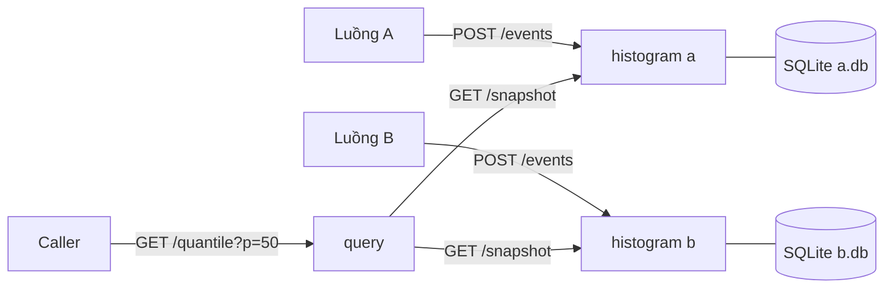

# Quantile qua nhiều shard bằng histogram logarithmic có sai số tương đối

Hai shard thu thập các quan sát từ hai luồng sự kiện rời nhau. Với dữ liệu
`[1, 1, 1]` ở A và `[1024]` ở B, trung bình của hai median cục bộ là
`512.5`. Median theo nearest rank của bốn quan sát có hạng 2 và giá trị
chính xác là `1`. Để tìm đúng bin chứa quan sát ở hạng đó, dịch vụ query
cộng số đếm theo từng bin rồi mới tính hạng toàn cục.

## Kiến trúc



`histogram.mts` chạy thành hai tiến trình với `HISTOGRAM_ID=a|b`. Mỗi
tiến trình sở hữu một tệp SQLite riêng qua `DB_PATH`. SQLite lưu danh tính
của shard cùng các bin và biên nhận. Khi mở lại tệp, danh tính trong tệp
phải khớp cấu hình trước khi mở cổng. Một giao dịch ghi cả biên nhận và
lần tăng bộ đếm. Retry đúng nội dung giữ nguyên cả hai. Snapshot đọc đủ
11 bộ đếm trong một câu SELECT rồi tính `total` từ chúng.

`query.mts` gọi song song hai origin HTTP cấu hình qua `SOURCE_A_ORIGIN`
và `SOURCE_B_ORIGIN`. Chúng phải trỏ đến `127.0.0.1` và khác nhau sau
chuẩn hóa. Địa chỉ và cổng đến lấy từ cấu hình tiến trình. Query chỉ nhận
tham số `p` từ caller. Mỗi lượt đọc dùng hai snapshot vừa nhận, cộng từng
cặp bin đúng một lần và trả về kết quả. Query giữ bảng đếm trong bộ nhớ
của lượt đọc.

## Chạy trên máy

Cần Node.js 24.12.0 trở lên trong dòng 24 và `curl`. Runtime dùng các
module có sẵn của Node.js, gồm SQLite. Chạy các lệnh từ thư mục gốc của
repo. Mỗi khối khởi động dưới đây chạy trong một terminal riêng.

Shard A

```bash
db_dir=$(mktemp -d) || exit 1
trap 'rm -rf -- "$db_dir"' EXIT
HOST=127.0.0.1 PORT=3078 HISTOGRAM_ID=a DB_PATH="$db_dir/a.db" \
  node lessons/78-logarithmic-quantiles/histogram.mts
```

Shard B

```bash
db_dir=$(mktemp -d) || exit 1
trap 'rm -rf -- "$db_dir"' EXIT
HOST=127.0.0.1 PORT=3079 HISTOGRAM_ID=b DB_PATH="$db_dir/b.db" \
  node lessons/78-logarithmic-quantiles/histogram.mts
```

Query

```bash
HOST=127.0.0.1 PORT=3178 SOURCE_A_ORIGIN=http://127.0.0.1:3078 \
  SOURCE_B_ORIGIN=http://127.0.0.1:3079 node lessons/78-logarithmic-quantiles/query.mts
```

Tiến trình sẵn sàng khi in một dòng JSON có `service` và `port`.
`HOST` mặc định là `127.0.0.1`. `PORT=0` nhờ hệ điều hành chọn một cổng
trống và số cổng thực xuất hiện trong dòng readiness. Dùng `Ctrl+C` để
dừng từng tiến trình. Muốn thử restart, chạy lại lệnh `node` kèm các
biến môi trường của shard trong cùng terminal để giữ nguyên `DB_PATH`.
Thư mục tạm của shard được xóa khi thoát shell đã tạo nó.

Trong terminal thứ tư, gửi ví dụ ở đầu bài rồi đọc quantile.

```bash
for id in shared a2 a3; do
  curl -fsS -H 'Content-Type: application/json' \
    --data "{\"id\":\"$id\",\"value\":1}" http://127.0.0.1:3078/events
  printf '\n'
done
curl -fsS -H 'Content-Type: application/json' \
  --data '{"id":"shared","value":1024}' http://127.0.0.1:3079/events
printf '\n'
curl -fsS http://127.0.0.1:3078/snapshot
printf '\n'
curl -fsS 'http://127.0.0.1:3178/quantile?p=50'
printf '\n'
```

Với cơ sở dữ liệu mới, A trả snapshot có `bins=[3,0,0,0,0,0,0,0,0,0,0]`,
B có một quan sát ở bin 10 và p50 trả
`{"total":4,"rank":2,"bin":0,"estimate":1.3333333333333333}`. Cùng ID
`shared` xuất hiện ở hai shard và hai quan sát đều được tính. Phạm vi của
biên nhận là một shard.

Chạy unit, HTTP integration và kiểm tra kiểu cho repo.

```bash
npm ci
npm run typecheck
node --test --test-timeout=15000 lessons/78-logarithmic-quantiles/test/lesson.test.mts
```

Test HTTP khởi động các tiến trình độc lập trên cổng do hệ điều hành
cấp. Fixture dùng tệp SQLite tạm riêng cho từng shard. Các case kiểm tra
retry, restart, đọc lặp, phản hồi nén hoặc quá lớn, body chia thành
nhiều phần và bộ đếm tại đích redirect.

## Hợp đồng HTTP

| Endpoint | Yêu cầu | Phản hồi |
| --- | --- | --- |
| `POST /events` | JSON chỉ gồm `id` là chuỗi 1–16 ký tự `a–z` hoặc `0–9` và `value` là số nguyên 1–1024 | Biên nhận mới trả `201 {id,duplicate:false}`. Cùng ID và giá trị trả `200 {id,duplicate:true}`. Cùng ID, khác giá trị trả `409 id_conflict`. ID mới khi đã có 64 biên nhận trả `429 capacity`. |
| `GET /snapshot` | Gọi shard A hoặc B với đường dẫn cố định | `200 {id,algorithm,total,bins}`. `id` là `a` hoặc `b`, `algorithm` là `log2-harmonic-v1`, `total` là số nguyên 0–64. Mảng `bins` có đúng 11 số nguyên 0–64 với tổng bằng `total`. |
| `GET /quantile?p=P` | Một tham số duy nhất, dạng thập phân chuẩn từ `0` đến `100` | `200 {total,rank,bin,estimate}`. Khi rỗng, `total=0` và ba trường còn lại là `null`. Với dữ liệu, `rank` bắt đầu từ 1 và `bin` bắt đầu từ 0. |

Lỗi có dạng `{"error":{"code":"invalid_request","message":"invalid_request"}}`
với `message` bằng `code`. Sai schema hoặc tham số trả
`400 invalid_request`. JSON sai cú pháp trả `400 invalid_json`.
`POST /events` dùng `application/json` và áp giới hạn 8.192 byte.
Media type khác trả `415 unsupported_media_type`. Body vượt giới hạn
trả `413 body_too_large`. Đường dẫn lạ trả `404 not_found` và sai
phương thức trả `405 method_not_allowed`.

Query chỉ chấp nhận HTTP `200` với snapshot hợp schema, đúng danh tính
và thuật toán. Một hạn chung 500 ms bao gồm cả hai lượt fetch, đọc hết
hai body, kiểm tra schema và tính kết quả. Bộ hẹn giờ hủy lượt đọc đang
chờ. Trước khi trả kết quả, query kiểm tra lại hạn bằng đồng hồ đơn điệu
để từ chối kết quả đến đúng hạn hoặc muộn hơn dù callback hủy còn chờ.

Mỗi body tối đa 8.192 byte. Hai shard gửi JSON không nén, nên query chỉ
chấp nhận phản hồi không có `Content-Encoding` hoặc có giá trị
`identity`. Nếu có `Content-Length`, query kiểm tra giá trị khai báo
trước rồi vẫn đếm số byte thực tế trong khi đọc. Redirect, lỗi kết nối,
status khác `200`, quá hạn, encoding hoặc độ dài không hợp lệ, body
quá lớn, UTF-8 lỗi, JSON lỗi hoặc snapshot sai hợp đồng đều trả
`502 upstream_failure`. Query hủy lượt đọc còn lại khi một shard lỗi
để tránh trả kết quả chỉ dựa trên một phần quan sát.

## Cách chọn bin và tính sai số

Histogram tuyến tính dùng khoảng có độ rộng cố định theo đơn vị đo.
Với histogram logarithmic, tỷ số giữa hai cận của mỗi khoảng là hằng
số. Bài này dùng `γ=2`. Bin `i=floor(log2(value))` bao phủ
`[2^i, 2^(i+1))`. Giá trị đúng lũy thừa của 2 bắt đầu bin mới. Mỗi
shard giữ đủ 11 bin cố định trong toàn miền và không gộp bin. Miền đầu
vào chỉ gồm số nguyên dương 1–1024, nên bin 10 chứa duy nhất `1024`.

Sau khi cộng số đếm, query tính hạng `max(1, ceil(P * total / 100))`.
Query đi từ bin nhỏ nhất và chọn bin đầu tiên có tổng tích lũy đạt hạng.
Tại p0, hạng là 1. Tại p100, hạng bằng số quan sát. Nếu có bốn quan sát
và p50, hạng là 2 theo quy tắc này.

Đặt `L=2^i`, `U=2L`. Giá trị đại diện dùng trung bình điều hòa
`m=2LU/(L+U)=4L/3`. Với quan sát chính xác `x` ở hạng cần tìm,
`m/x` giảm khi `x` đi từ `L` đến `U`. Tại hai cận, `m/L=4/3`
và `m/U=2/3`, nên `|m-x|/x ≤ 1/3`. Biên trên được dùng trong phép
chứng minh dù khoảng bin mở ở đầu đó. Công thức áp dụng cả bin 10 và
trả `4096/3` cho quan sát `1024`. Query giữ nguyên kết quả biểu diễn
bằng số thực của JavaScript, không làm tròn hay chặn ở 1024.

Đây là chặn sai số theo **giá trị** so với quan sát ở hạng đã chọn. Vị trí
tích lũy xác định được bin chứa hạng đó, còn khoảng cách theo hạng khi
dùng giá trị đại diện làm ngưỡng phụ thuộc vào phân bố bên trong bin.

## Đánh đổi và giới hạn

- Cùng hệ bin cho phép cộng số đếm mà không cần truyền mẫu riêng lẻ.
  Mỗi snapshot gửi 11 bộ đếm; tổng hợp tốn thời gian tuyến tính theo
  số bin. Biên nhận vẫn lưu từng ID và giá trị để bảo đảm retry đúng
  hợp đồng. Giới hạn 64 giữ chi phí lưu trữ của ví dụ hữu hạn.
- Bin độ rộng tăng dần giúp chặn sai số tương đối trên miền dương. Với
  `γ=2`, sai số tối đa 1/3 khá thô. Thu hẹp tỷ số cận bin giảm sai số
  và cần nhiều bin hơn để phủ cùng một miền.
- Hai snapshot có thể được đọc tại hai thời điểm khác nhau. Kết quả áp
  dụng cho hợp của đúng hai snapshot đã nhận. Nếu ghi đồng thời lên hai
  nguồn, lượt đọc này không tạo một mốc nhất quán toàn hệ thống.
- Bài học dùng miền nhỏ và bin cố định để minh họa ý tưởng lấy cảm hứng
  từ DDSketch. Cách chọn miền, ánh xạ và giữ đủ bin ở đây là quy ước của
  bài, không mô phỏng các biến thể lưu bin hay collapse của DDSketch.

## Bài tập

1. Gửi các cặp giá trị `7, 8`, `511, 512` và `1023, 1024`. Tính
   trước bin và giá trị đại diện của p0, p50, p100 rồi đối chiếu API.
2. Thử đổi `γ` thành `√2` trên giấy. Tính số bin để phủ 1–1024 và
   chứng minh chặn sai số giá trị cho hai cận liên tiếp. Xác định lý do
   cần version mới nếu triển khai cấu hình đó ở cả hai shard.
3. Gửi thêm sự kiện trong lúc đọc snapshot. Đề xuất cách đặt mốc quan
   sát chung và nêu trạng thái mà query phải xử lý khi chỉ một shard
   đã đến mốc.

## Tài liệu gốc

- Bài báo *DDSketch: A Fast and Fully-Mergeable Quantile Sketch with Relative-Error Guarantees*. [arXiv](https://arxiv.org/abs/1908.10693)
- Mã nguồn Go và tài liệu về các cấu hình lưu trữ của DDSketch. [DataDog/sketches-go](https://github.com/DataDog/sketches-go)
